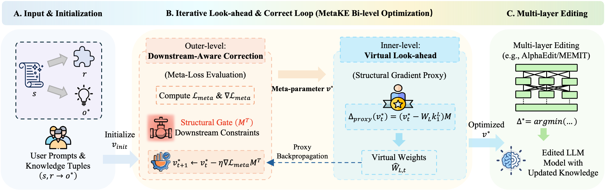

# MetaKE: Meta-Learning for Knowledge Editing Toward a Better Accuracy-Editability Trade-off

## 🌟 Overview

- MetaKE proposes a downstream-aware meta-learning framework for Knowledge Editing. Existing locate-then-edit methods usually separate editing into two stages: upstream target representation optimization and downstream constrained parameter optimization. However, the upstream stage applies uniform regularization without knowing how much of the planned residual can actually be realized by the downstream update.

- MetaKE addresses this two-stage disconnect by formulating knowledge editing as a bi-level optimization problem. The inner level performs the downstream constrained parameter update, while the outer level refines the target representation using feedback from downstream constraints.

- To make this process efficient, MetaKE introduces a Structural Gradient Proxy, which approximates downstream-aware feedback without full multi-layer backpropagation. By refining the target representation before the final multi-layer edit, MetaKE improves the accuracy-editability trade-off and better preserves unrelated knowledge during sequential editing.




## 🏗️ Requirements

**At least one NVIDIA A100 GPU.**

- torch==2.6.0
- einops==0.8.1
- higher==0.2.1
- hydra-core==1.3.2
- transformers==4.51.3
- datasets==2.21.0
- matplotlib==3.10.3
- spacy==3.4.1
- scipy==1.15.2
- scikit-learn==1.6.1
- nltk==3.9.1

## 🚀 Quick Start

### An example for editing Llama3 (8B) on counterfact dataset using CAKE

### 1. Edit LLaMA3-8B model

    python3 -m experiments.evaluate \
            --alg_name=MetaKE \
            --model_name=meta-llama/Meta-Llama-3-8B-Instruct \
            --hparams_fname=Llama3-8B.json \
            --ds_name=mcf \
            --dataset_size_limit=2000 \
            --num_edits=100 \
            --downstream_eval_steps=5

This command runs an evaluation script for MetaKE using LLaMA3-8B-Instruct. Below are the explanations for each argument:

- `alg_name=MetaKE`: Specifies the editing algorithm.

- `model_name=meta-llama/Meta-Llama-3-8B-Instruct`: Specifies the backbone model.

- `hparams_fname=Llama3-8B.json`: Points to the hyperparameter file for LLaMA3-8B.

- `ds_name=mcf`: Specifies the dataset name. "mcf" denotes CounterFact.

- `dataset_size_limit=2000`: Sets the number of editing samples to 2000.

- `num_edits=100`: Defines the batch size for each round of editing.

- `downstream_eval_steps=5`: Conducts downstream evaluation every 5 editing rounds.


Results from each run are stored at `results/<method_name>/run_<run_id>` in a specific format:

```bash
results/
|__ MetaKE/
    |__ run_<run_id>/
        |__ params.json
        |__ case_0.json
        |__ case_1.json
        |__ ...
        |__ case_1999.json
```

---

#### 2. Summarize the results  
To summarize the results, you can use [`experiments/summarize.py`](../experiments/summarize.py):

    python summarize.py --dir_name=Cake --runs=run_<run1>,run_<run2>


## 🧪 Hyperparameters

Key hyperparameters in `hparams/MetaKE/Llama3-8B.json`:

- `layers`: List of layer indices to edit (e.g., [4, 5, 6, 7, 8])

- `meta_steps`: Number of target-refinement iterations.

- `meta_lr`: Learning rate for meta-level target refinement.


Example configuration:

```json
{
    "layers": [4, 5, 6, 7, 8],
    ......
    "meta_steps": 15,
    "meta_lr": 0.005,
}
```